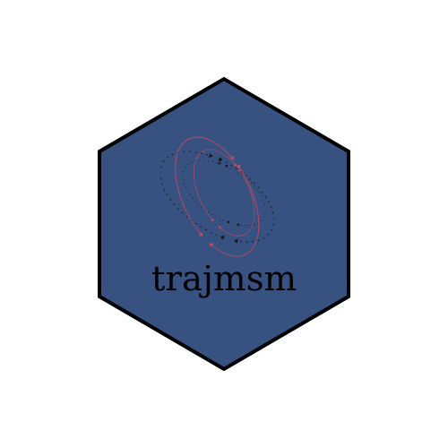

# trajmsm

<p align="center">
  
</p>

**Estimate marginal structural models for longitudinal treatment trajectories.** `trajmsm` combines latent class growth analysis (LCGA) with marginal structural models (MSMs) to study treatment trajectories when confounders change over time. The package also supports history-restricted MSMs (HRMSMs) for questions about a recent treatment history and a time-indexed outcome.

## Start here

Install the current CRAN release:

```r
install.packages("trajmsm")
library(trajmsm)
```

Then follow the [**getting-started vignette**](docs/getting-started.md) or run the [complete R example](docs/getting-started.R). The example uses simulated data to build trajectory groups, compute and inspect treatment weights, fit an MSM, and interpret the estimates. The vignette also explains when to use long or wide data and which function to start with.

## Choose a function

| Goal | Functions |
| --- | --- |
| Simulate data, fit or plot trajectory groups | `gendata()`, `build_traj()`, `ggtraj()` |
| Estimate longitudinal treatment weights, optionally including censoring | `inverse_probability_weighting()` |
| Fit an MSM for a full treatment history | `trajmsm_ipw()`, `trajmsm_gform()`, `trajmsm_pltmle()` |
| Fit an MSM for rolling windows of recent treatment history | `trajhrmsm_ipw()`, `trajhrmsm_gform()`, `trajhrmsm_pltmle()` |

Use `help(package = "trajmsm")` for the function reference.

## Reference

Diop A, Sirois C, Guertin JR, Schnitzer ME, Candas B, Cossette B, Poirier P, Brophy J, Mésidor M, Blais C, Talbot D. (2023). Marginal Structural Models with Latent Class Growth Analysis of Treatment Trajectories. *Statistical Methods in Medical Research*. [doi:10.1177/09622802231202384](https://doi.org/10.1177/09622802231202384).

For related methodological examples, see the [trajectory analysis repository](https://github.com/awamaeva/trajectory_analysis).
