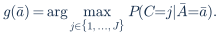
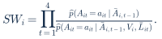
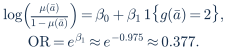

# trajmsm companion guide

[Package home](../README.md) · [Complete R script](getting-started.R)

## Why combine trajectory analysis and marginal structural models?

A treatment history records what a person received at each visit. Four visits with a binary treatment already allow 16 different histories. **Latent class growth analysis (LCGA)** summarizes the treatment patterns observed in the data into a few groups. Those groups make the patterns easier to describe, but grouping does not adjust for confounding.

**Why 16 histories?**


At every visit the person can be treated or untreated. Multiplying the two choices across four visits counts all complete histories, whether or not every history appears in the observed sample.

A **marginal structural model (MSM)** describes how the population-average outcome would differ under specified treatment histories. For example, a health measure can affect whether someone is treated next and their eventual outcome, while itself being affected by earlier treatment. Ignoring it can leave confounding, but ordinary outcome regression that conditions on it can block part of an earlier treatment's effect. The worked example uses inverse probability weighting (IPW) for the treatment decisions over time.

In the [original LCGA-MSM methods paper (Diop et al., 2023)](https://doi.org/10.1177/09622802231202384), LCGA is fitted to observed histories, then the fitted classification rule maps each hypothetical treatment history to a group. The formal target is a **projection**: it summarizes the history-specific mean outcomes under those hypothetical histories using a simpler, group-based working MSM. The treatment histories, not the latent group labels, are the interventions. Two histories in one group can still have different effects; a group contrast summarizes the histories under the chosen working model and does not estimate the effect of assigning someone to a class.

**How is a history assigned to a group?**



The fitted LCGA computes a posterior probability for each of its J classes (C). For a history ā, g chooses the class with the largest fitted probability. This applies to observed histories and to hypothetical ones; it is a classification rule, not a treatment assignment rule.

## A worked example: from treatment histories to a weighted estimate

**Learning goal.** Fit a latent class growth analysis–marginal structural model (LCGA-MSM) using inverse probability weighting (IPW). Along the way, check how the data layout, trajectory assignments, and weights affect the analysis. The data are simulated; the results do not estimate an effect in a real population.

**Follow the analysis:** [Choose the data layout](#1-pick-the-analysis-and-the-data-format) · [Fit trajectories](#2-fit-the-trajectory-model-in-long-format) · [Check the weights](#3-prepare-the-wide-data-and-diagnose-treatment-weights) · [Fit and interpret the model](#4-fit-and-interpret-the-weighted-model).

Run the complete example from the repository root after installing `trajmsm`:

```sh
Rscript docs/getting-started.R
```

In RStudio, open the script and source it instead. It uses base R, `trajmsm` and its dependency `sandwich`, and prints the session information for reproducibility.

## 1. Pick the analysis and the data format

| Question or task | Input layout | Starting function |
| --- | --- | --- |
| Which patterns summarize the observed treatment histories? | **Long:** one row per person and visit | `build_traj()` |
| What are the cumulative treatment weights? | **Wide:** one row per person, with a separate column per measurement occasion and variable | `inverse_probability_weighting()` |
| How are trajectory groups related to a final outcome under a working MSM? | Wide for the final-outcome analysis shown here; first fit the trajectory model in long format | `trajmsm_ipw()`, `trajmsm_gform()`, or `trajmsm_pltmle()` |
| How does a recent treatment history relate to a time-indexed outcome? | Long input to the history-restricted wrapper | `trajhrmsm_ipw()`, `trajhrmsm_gform()`, or `trajhrmsm_pltmle()` |

IPW models the treatment mechanism and, when requested, the censoring mechanism. G-computation models the outcome regressions. Pooled longitudinal targeted maximum likelihood estimation (LTMLE) uses models for both the outcome and treatment process and a targeting step. These are alternative estimators for an analysis, not interchangeable commands with identical inputs. The g-formula and pooled LTMLE enumerate binary treatment histories: four treatment occasions have 16 histories and eight have 256. History-restricted analyses work on windows of length `ntimes_interval` within `total_followup`.

## 2. Fit the trajectory model in long format

The script creates four annual visits per person. Here `statins` is a binary simulated treatment, `hyper` and `bmi` are simulated binary time-varying covariates, and `y` is a binary end-of-follow-up outcome repeated across a person's long rows. It is not four separate outcome observations.

```r
years <- 2011:2014
long <- gendata(n = 800, start_year = years[1], total_followup = length(years),
                format = "long", seed = 845)
trajectory <- build_traj(
  obsdata = long, formula = cbind(statins, 1 - statins) ~ I(time - 2011),
  number_traj = 2, identifier = "id", seed = 945
)
```

Check that the fit recovered the requested number of groups, inspect group sizes and posterior assignment probabilities, and review whether the trajectories make sense for the study. Class numbers are arbitrary. The script joins the assignment to the person-level data **by ID**, not by row order, and uses the group with lower observed average adherence as the reference for illustration. Choosing a class count and reference for a real analysis calls for scientific justification. The script prints `table(classes$class)` and `BIC(trajectory$traj_model)`. Lower BIC can help compare candidate models fitted to the same data; also examine separation, stability and substantive usefulness rather than choosing the number from BIC alone.

Add `--plot` to the command above to save `observed-trajectories.pdf`. The plot shows observed proportions treated within assigned classes at each visit, not fitted trajectories or causal effects.

## 3. Prepare the wide data and diagnose treatment weights

The script reshapes the visit-level variables to names like `statins2011` and `hyper2011`. The final outcome and baseline variables stay one column each. Specify the treatment columns chronologically and pass a list of covariate vectors in that **same** order. Verify which covariates the analyst observes before treatment at each visit. Example:

```r
treatment <- paste0("statins", years)
covariates <- lapply(years, function(year) paste0(c("hyper", "bmi"), year))
weights_by_time <- inverse_probability_weighting(
  numerator = "stabilized", identifier = "id", baseline = c("age", "sex"),
  treatment = treatment, covariates = covariates, include_censor = FALSE,
  obsdata = wide
)[[1]]
w <- weights_by_time[, length(years)]
```

**What goes into the stabilized treatment weight?**



At each visit t for person i, use the fitted probability of the treatment actually received (aᵢₜ). The numerator conditions on earlier treatment only (at visit 1 it is unconditional). The denominator also includes baseline covariates Vᵢ (age and sex here) and measured time-varying covariates L through the current visit, taken before its treatment decision. Multiply the four ratios to get the final weight; this example does not add censoring weights. See the weight code just above.

Illustration (not simulation output): If the person was untreated at a visit and the numerator and denominator models give probabilities of treatment of 0.40 and 0.70, use the probabilities of no treatment: (1 − 0.40) / (1 − 0.70) = 2. That visit doubles the cumulative weight so far.

The first list element is a matrix of cumulative weights with one column per occasion and one row per input person. The final column weights the full treatment history in this example. Keep those weights aligned to the exact rows passed to the outcome model. If you reorder or subset the data, explicitly reindex weights by a unique person ID before fitting; the wrapper does not realign weights by name.

Inspect the weight distribution, large weights, and effective sample size, overall and by group. The script calculates effective sample size as `sum(w)^2 / sum(w^2)`. It is a weight-concentration summary, not a literal number of people or a guarantee of overlap, balance, or identification. For a real study, also check treatment probabilities and covariate balance at each decision point, address missingness and censoring explicitly, and inspect whether important histories have treatment support.

## 4. Fit and interpret the weighted model

```r
weights_by_id <- setNames(w, wide$id)
wide$iptw <- unname(weights_by_id[as.character(wide$id)])
fit <- glm(y ~ trajectory, family = quasibinomial(), data = wide, weights = iptw)
se <- sqrt(diag(sandwich::vcovCL(fit, cluster = ~ id)))
```

Here the outcome model is fitted directly with `stats::glm()`, so the weights and variance calculation are visible. The script presents the diagnosed weights first, then a separately labeled sensitivity fit using `pmin(w, quantile(w, .99))` to cap the upper tail. This cap illustrates a comparison, not a default recommendation.

**From log odds to an odds ratio**



Here μ(ā) is the working-model event probability for history ā. The indicator equals one for group 2 and zero for the reference group 1. The weighted logistic mean model (the logit link in the quasibinomial fit above) estimates β₁ as about −0.975 in the simulated example. Exponentiating yields the modeled odds in group 2 divided by those in group 1, not a ratio of event probabilities.

The script builds a coefficient table with estimates, person-ID–clustered standard errors and 95% Wald confidence limits. Here the intercept is the modeled log odds in the reference trajectory group, and the trajectory coefficient is a log odds ratio against that group. Exponentiate the coefficient and confidence limits to report an odds ratio and its interval, not the standard error; this is **not** a risk ratio. The standard errors reported by this fit do not, by themselves, establish that first-stage weight and latent-class estimation uncertainty has been fully propagated.

LCGA is a summary of treatment histories, not a randomization step and not itself a treatment intervention. A causal interpretation depends on defining the intervention and target parameter, consistency, sequential exchangeability, positivity, and appropriate nuisance and working-model choices.

### Optional: use the package wrapper (0.1.7 or newer)

With the same outcome formula and ID-aligned weights from above, the wrapper should reproduce the direct fit’s estimates and clustered standard errors:

```r
if (packageVersion("trajmsm") >= "0.1.7") {
  wrapped <- trajmsm_ipw(
    formula1 = y ~ trajectory, family = "quasibinomial", identifier = "id",
    obsdata = wide, weights = wide$iptw
  )
  direct_se <- sqrt(diag(sandwich::vcovCL(fit, cluster = ~ id)))
  stopifnot(isTRUE(all.equal(wrapped[, "Estimate"], coef(fit))),
            isTRUE(all.equal(wrapped[, "Std.Error"], direct_se)))
}
```

Both fits deliberately use the quasibinomial family with its default logit link. In base R, binomial GLMs can warn about non-integer successes when supplied fractional inverse-probability weights: these weights are not counts of binomial trials. The quasibinomial fit keeps the same logit mean model without that count warning. Inference here uses the explicit person-clustered sandwich covariance.

## If you get stuck

- **Missing columns or a surprising join:** verify that long data have unique person–time keys, wide rows have unique person IDs, and every final outcome row matches one trajectory assignment.
- **Fewer classes than requested:** inspect model fit and group sizes; do not set the requested number mechanically or reinterpret arbitrary class labels as fixed treatment strategies.
- **Non-finite or extreme weights:** inspect fitted treatment probabilities, missing values and support. A numerical cap cannot restore identification where support is absent.
- **Moving to a survival or history-restricted analysis:** consult the function-specific help before changing the example. The formulas, censoring, clustering, and outcome scale differ; in the survival branch of `trajmsm_ipw()`, the Cox formula is supplied as `formula2`.
